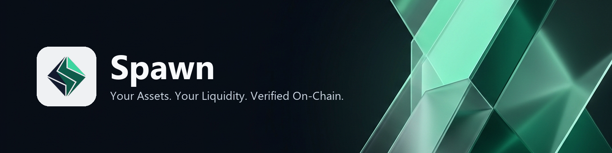
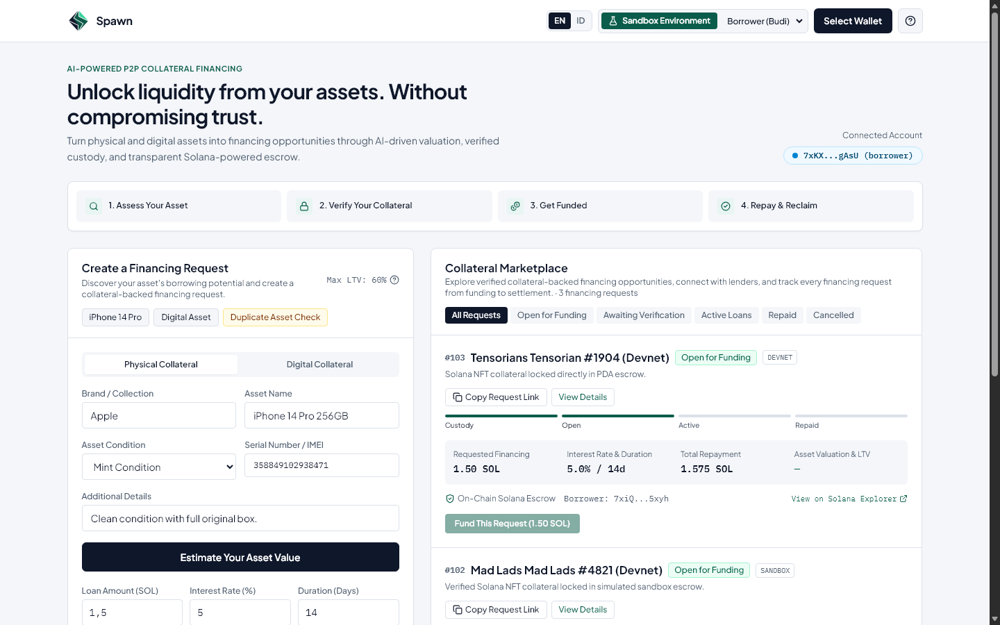
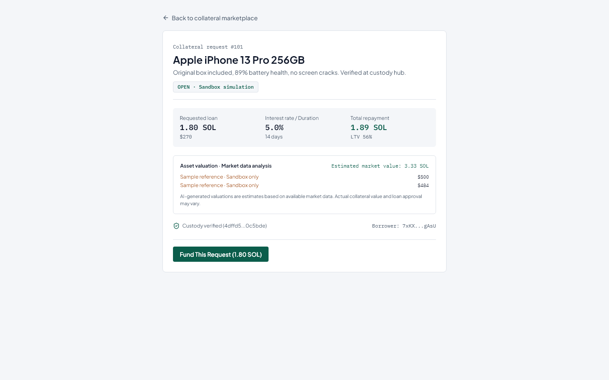
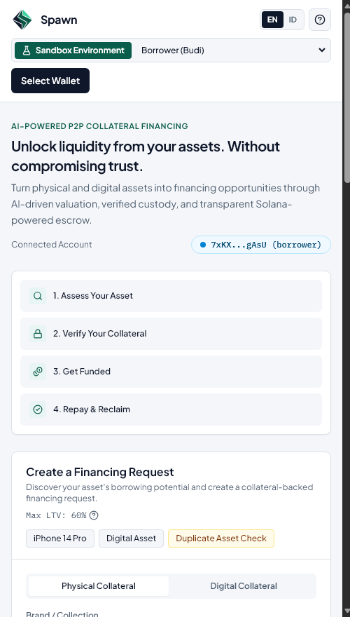
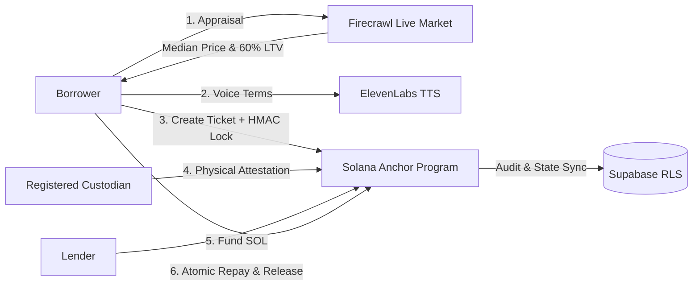

<p align="center">
  
</p>

<h1 align="center">Spawn</h1>

<p align="center">
  <strong>AI-Powered P2P Collateral Financing for Physical &amp; Digital Assets on Solana</strong><br/>
  <em>Your Assets. Your Liquidity. Verified On-Chain.</em>
</p>

<p align="center">
  <a href="https://spawn-solana.vercel.app/"></a>
  <a href="https://explorer.solana.com/address/GbnsM4PrEhhUR462vCDiCY5wrzj4MHyTSwRFieUhYn4G?cluster=devnet"></a>
  
  
  <a href="LICENSE"></a>
</p>

<p align="center">
  <a href="#-60-second-judge-walkthrough">Judge Walkthrough</a> •
  <a href="#-product-showcase">Screenshots</a> •
  <a href="#-architecture">Architecture</a> •
  <a href="#-sponsor-integrations">Sponsors</a> •
  <a href="#-smart-contract">Smart Contract</a> •
  <a href="#-quick-start">Quick Start</a>
</p>

---

## Overview

**Spawn** connects borrowers who need instant short-term liquidity with individual P2P lenders — without selling their physical valuables or digital assets.

- **Real-Time Market Appraisal (Firecrawl):** Scrapes live secondary-market listings, computes a conservative median valuation, and enforces a strict **60% max LTV** cap. On Devnet, physical asset pledges are rejected if fewer than two live listings are found.
- **Anti Double-Pledge Protection (On-Chain PDA):** Serial numbers / IMEIs are hashed with an HMAC fingerprint into an on-chain `CollateralLock` PDA, blocking duplicate active pledges across the protocol (`409 POTENTIAL_DUPLICATE`).
- **Atomic Solana Escrow (Anchor):** Single-supply collateral tokens are locked in a program-derived escrow account; loan repayment and collateral release execute atomically in a single instruction (`repay_and_release`).
- **Voice Contract Briefing (ElevenLabs):** Reads principal, interest rate, duration, total repayment, and default rules aloud before signing — supporting both **English** and **Bahasa Indonesia**.
- **Two Isolated Environments:** **Sandbox Mode** (instant demo without a wallet) and **Solana Devnet Mode** (real Phantom/Solflare transactions verifiable on Solana Explorer).

---

## 📸 Product Showcase

| Desktop Marketplace & Appraisal | Ticket Detail & Solana Explorer |
| :---: | :---: |
|  |  |

<details>
<summary><strong>📱 Mobile Responsive View</strong> (click to expand)</summary>
<br/>
<p align="center">
  
</p>
</details>

---

## ⚡ 60-Second Judge Walkthrough

Try it live at **[https://spawn-solana.vercel.app/](https://spawn-solana.vercel.app/)** — **Sandbox Mode** is active by default, so no wallet or SOL is required:

1. **Instant Appraisal & Voice Briefing:** Click the **iPhone 14 Pro** preset → **Estimate Your Asset Value** → **Listen to Loan Terms** to hear the live contract briefing.
2. **Double-Pledge Detection:** Click the **Duplicate Asset Check** preset → **Estimate Your Asset Value** to trigger the anti-fraud duplicate lock (`409 POTENTIAL_DUPLICATE`).
3. **Full 4-Step Lifecycle:**
   - Submit a financing request as **Borrower** (`PENDING_VERIFICATION`)
   - Switch role to **Custodian Hub** → **Verify & Approve Custody** (`OPEN`)
   - Switch role to **Lender** → **Fund This Request** (`ACTIVE`)
   - Switch back to **Borrower** → **Repay & Reclaim Collateral** (`REPAID`)
4. **Solana Devnet Mode:** Toggle **Sandbox → Solana Devnet** in the header, connect Phantom/Solflare, and inspect every escrow transaction directly on Solana Explorer.

---

## 🏗 Architecture



### Repository Structure

```text
apps/web/             Next.js 16 App Router (UI, REST API routes, Solana Wallet Adapter)
programs/pawnchain/   Solana Anchor program (escrow PDA, custodian registry, CollateralLock)
supabase/             PostgreSQL migrations (001_init.sql + 002_enable_rls.sql)
docs/                 PRD, hackathon assets, screenshots, and audit notes
```

---

## 🤝 Sponsor Integrations

| Sponsor / Track | Role in Spawn | Key Files |
|---|---|---|
| **Solana (Anchor)** | Atomic PDA escrow, on-chain Custodian Registry, `CollateralLock` anti-double-pledge PDA | [`programs/pawnchain/src/lib.rs`](programs/pawnchain/src/lib.rs), [`apps/web/src/lib/program.ts`](apps/web/src/lib/program.ts) |
| **Firecrawl** | Live secondary-market price scraping to compute conservative median & 60% LTV cap | [`apps/web/src/lib/appraisal.ts`](apps/web/src/lib/appraisal.ts) |
| **ElevenLabs** | Bilingual (EN/ID) voice contract briefing reading principal, interest, tenor, and default rules before signing | [`apps/web/src/app/api/v1/voice/contract-briefing/route.ts`](apps/web/src/app/api/v1/voice/contract-briefing/route.ts) |
| **Supabase** | PostgreSQL ledger & audit log persistence with Row-Level Security enabled | [`supabase/migrations/001_init.sql`](supabase/migrations/001_init.sql), [`supabase/migrations/002_enable_rls.sql`](supabase/migrations/002_enable_rls.sql) |

---

## 📜 Smart Contract

- **Program ID (Devnet):** [`GbnsM4PrEhhUR462vCDiCY5wrzj4MHyTSwRFieUhYn4G`](https://explorer.solana.com/address/GbnsM4PrEhhUR462vCDiCY5wrzj4MHyTSwRFieUhYn4G?cluster=devnet)

| Instruction | Signer | Purpose |
|---|---|---|
| `register_custodian`, `revoke_custodian` | Program Upgrade Authority | Manage authorized physical-asset custodians |
| `create_pawn_ticket`, `repay_and_release`, `cancel_ticket` | Borrower | Lock collateral, atomically repay & reclaim, or cancel unfunded tickets |
| `submit_custody_attestation` | Registered Custodian | Attest physical collateral verification on-chain |
| `fund_loan`, `claim_default` | Lender | Fund open tickets in SOL or claim collateral upon default |

Deploy to Devnet (WSL/Linux, ~2.1 devnet SOL):

```bash
bash programs/pawnchain/deploy-devnet.sh
```

Register a custodian wallet from `apps/web`:

```bash
node --experimental-strip-types scripts/custodian.mts <admin-keypair.json> register <custodian-pubkey>
```

---

## 🚀 Quick Start

```bash
cd apps/web
pnpm install
cp ../../.env.example .env.local
pnpm dev
```

Open `http://localhost:3000`. **Sandbox mode** works out of the box without API keys. Devnet physical-asset appraisals require `FIRECRAWL_API_KEY` (ElevenLabs falls back to browser speech synthesis if `ELEVENLABS_API_KEY` is omitted).

---

## 🧪 Tests

Run from `apps/web`:

| Command | Requirements |
|---|---|
| `node tests/e2e-api.mjs` | Running Next.js server (`pnpm dev` or `pnpm start`) |
| `node --experimental-strip-types scripts/chain-e2e.mts <admin.json>` | Local Solana validator with program loaded & `<admin.json>` as upgrade authority |
| `node --experimental-strip-types --import ./scripts/ts-resolve.mjs scripts/devnet-flow.mts <admin.json>` | Local validator + dev server started with `NEXT_PUBLIC_SOLANA_RPC_URL=http://127.0.0.1:8899` |

---

## ⚠️ Known Limitations

- This is a **Devnet prototype**, not a licensed pawn business or legal proof of ownership.
- Physical items rely on a registered custodian; physical handover after repayment or default occurs off-chain.
- The 60% LTV cap is enforced by the app during listing rather than on-chain (no on-chain price oracle).
- Custodians attest the ticket and its serial/IMEI fingerprint, not the full item description.
- Digital collateral requires a token with supply `1`, `0` decimals, and no mint/freeze authority (standard Metaplex NFTs are not accepted; Devnet digital pledges are unappraised).
- Sandbox state is open for frictionless demoing without wallet auth; Devnet state is enforced by Solana signatures and PDAs.
- The SOL/IDR display rate uses a fixed demo conversion value.
- Because the appraisal endpoint computes a fingerprint for any serial string, an early caller could pre-lock a serial on-chain without physical inspection until custodian attestation.

---

## 📄 License

MIT — see [`LICENSE`](LICENSE).
