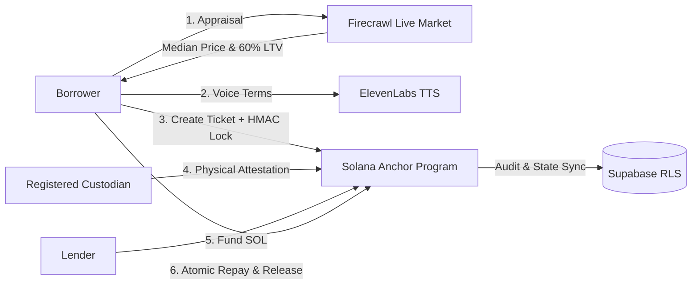

# PawnChain

**P2P pawnshop for physical and digital collateral on Solana**  
Built for **Dev3pack Global Hackathon** (27–29 November 2026)

## Overview

PawnChain connects people who need short-term cash with individual lenders.

1. **Market appraisal (Firecrawl):** takes the median of live marketplace listings and caps the loan at 60% LTV. With fewer than two listings, a devnet pledge for a physical item is refused.
2. **Solana escrow (Anchor):** a single-supply collateral token is held by a PDA; repayment and release happen in one instruction.
3. **Custody and anti double-pledge:** only custodians registered on chain can attest a physical item. An on-chain lock keyed by an HMAC of the serial/IMEI rejects a second active pledge.
4. **Voice briefing (ElevenLabs):** reads the loan terms aloud before confirmation.
5. **Two clearly separated modes:** *Sandbox* is simulated with sample prices; *Devnet* tickets change only to match on-chain accounts.

## Architecture



```text
apps/web/           Next.js 16 App Router (UI, API routes, wallet adapter)
programs/pawnchain/ Anchor program (escrow, custodian registry, CollateralLock)
supabase/           PostgreSQL migrations (001_init.sql + 002_enable_rls.sql)
docs/               PRD, ideation, resources, and status audit
```

## Sponsor Integrations

| Sponsor / Track | Role in PawnChain | Key Files |
|---|---|---|
| **Solana (Anchor)** | Atomic PDA escrow, on-chain Custodian Registry, `CollateralLock` anti-double-pledge PDA | [`programs/pawnchain/src/lib.rs`](programs/pawnchain/src/lib.rs), [`apps/web/src/lib/program.ts`](apps/web/src/lib/program.ts) |
| **Firecrawl** | Live secondary-market price scraping to compute conservative median & 60% LTV cap | [`apps/web/src/lib/appraisal.ts`](apps/web/src/lib/appraisal.ts) |
| **ElevenLabs** | Voice contract briefing reading principal, interest, tenor, and default rules before signing | [`apps/web/src/app/api/v1/voice/contract-briefing/route.ts`](apps/web/src/app/api/v1/voice/contract-briefing/route.ts) |
| **Supabase** | PostgreSQL ledger & audit log persistence with Row-Level Security enabled | [`supabase/migrations/001_init.sql`](supabase/migrations/001_init.sql), [`supabase/migrations/002_enable_rls.sql`](supabase/migrations/002_enable_rls.sql) |

## Judge Quick Test (60 Seconds)

1. Open the app (Sandbox Mode is enabled by default — no wallet setup required).
2. Click **Demo: iPhone 14 Pro** → **Run AI Market Appraisal** (see live Firecrawl pricing & 60% LTV cap) → **Listen to Contract Summary** (ElevenLabs voice).
3. Click **Test Duplicate IMEI** → **Run AI Market Appraisal** to see the HMAC anti-fraud block (`409 POTENTIAL_DUPLICATE`).
4. Submit a ticket as **Borrower**, switch role to **Custodian Hub** to verify check-in (`PENDING_VERIFICATION → OPEN`), switch to **Lender** to fund (`OPEN → ACTIVE`), and switch back to **Borrower** to repay (`ACTIVE → REPAID`).

## Quick start

```bash
cd apps/web
pnpm install
cp ../../.env.example .env.local
pnpm dev
```

Open `http://localhost:3000`. Sandbox mode works without any key. Devnet pledges of physical items need `FIRECRAWL_API_KEY`.

## Smart contract

Program ID: `GbnsM4PrEhhUR462vCDiCY5wrzj4MHyTSwRFieUhYn4G`

| Instruction | Signer |
|---|---|
| `register_custodian`, `revoke_custodian` | Program upgrade authority |
| `create_pawn_ticket`, `repay_and_release`, `cancel_ticket` | Borrower |
| `submit_custody_attestation` | Registered custodian |
| `fund_loan`, `claim_default` | Lender |

Deploy (WSL/Linux, about 2.1 devnet SOL):

```bash
bash programs/pawnchain/deploy-devnet.sh
```

Register a custodian wallet, from `apps/web`:

```bash
node --experimental-strip-types scripts/custodian.mts <admin-keypair.json> register <custodian-pubkey>
```

## Tests

From `apps/web`:

| Command | Needs |
|---|---|
| `node tests/e2e-api.mjs` | Dev server |
| `node --experimental-strip-types scripts/chain-e2e.mts <admin.json>` | Local validator with the program loaded, `<admin.json>` as upgrade authority |
| `node --experimental-strip-types --import ./scripts/ts-resolve.mjs scripts/devnet-flow.mts <admin.json>` | The above, plus the dev server started with `NEXT_PUBLIC_SOLANA_RPC_URL=http://127.0.0.1:8899` |

## Known limitations

- This is a devnet prototype, not a licensed pawn business or legal proof of ownership.
- Physical items rely on a trusted custodian; handover after repayment or default happens off chain.
- The LTV cap is enforced by the app when listing, not by the program (there is no price oracle).
- Custodians do not sign the item description; they attest the ticket and its fingerprint.
- Digital collateral must be a token with supply 1, 0 decimals and no mint or freeze authority, so standard Metaplex NFTs are not accepted. Digital pledges on devnet are unappraised.
- The app has no wallet sign-in. Devnet state is protected by the chain; sandbox state is open to anyone.
- The SOL/IDR rate is a fixed demo value.

## License

MIT — see [`LICENSE`](LICENSE).
